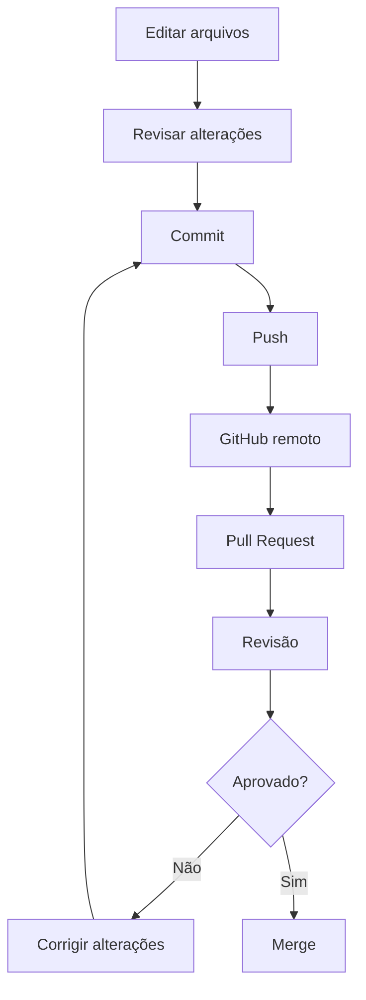
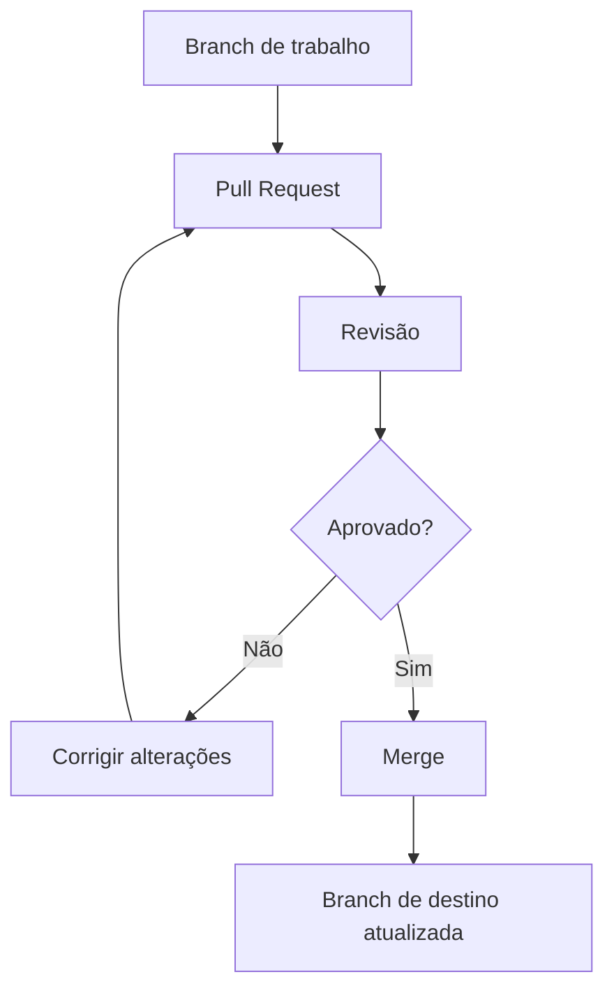
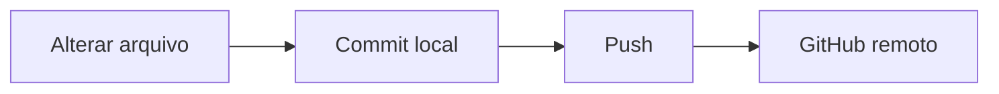
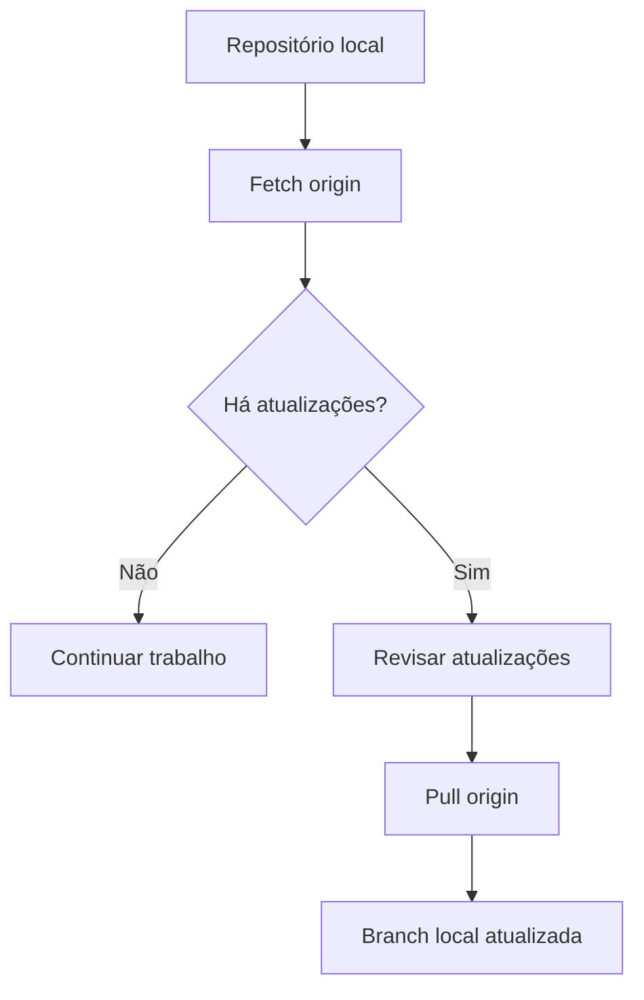
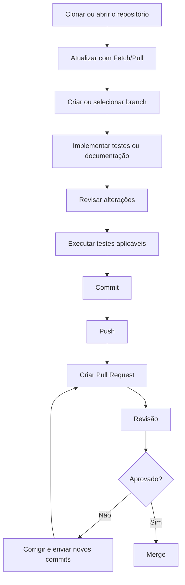

# Guia Prático de GitHub Online e GitHub Desktop para QA


Guia passo a passo para aprender a utilizar o GitHub pelo navegador e pelo GitHub Desktop, com foco em controle de versão, organização de projetos, colaboração e práticas aplicadas à Qualidade de Software (QA).

## Objetivos

Ao concluir este guia, você será capaz de:

- Criar repositórios públicos e privados.
- Clonar e abrir repositórios existentes.
- Criar e gerenciar branches.
- Fazer commit, push, fetch e pull.
- Comparar alterações entre arquivos e branches.
- Criar Pull Requests e realizar merges.
- Remover arquivos com segurança.
- Organizar projetos de testes de software no GitHub.

## Sumário

1. [Conceitos fundamentais](#1-conceitos-fundamentais)
2. [GitHub Online](#2-github-online)
3. [GitHub Desktop](#3-github-desktop)
4. [Fluxo de trabalho para QA](#4-fluxo-de-trabalho-para-qa)
5. [Exercício prático](#5-exercício-prático)
6. [Problemas comuns](#6-problemas-comuns)
7. [Glossário](#7-glossário)
8. [Documentação oficial](#8-documentação-oficial)

---

# 1. Conceitos fundamentais

Antes de utilizar as ferramentas, é importante entender a diferença entre Git e GitHub.

- **Git:** sistema de controle de versão que registra as alterações dos arquivos.
- **GitHub:** plataforma online que hospeda repositórios Git e facilita a colaboração.
- **GitHub Desktop:** aplicativo gráfico para trabalhar com repositórios Git sem depender exclusivamente do terminal.

## 1.1 Principais operações

| Operação | O que faz |
|---|---|
| Commit | Registra alterações no histórico local. |
| Push | Envia commits locais para o repositório remoto. |
| Fetch | Busca informações do remoto sem integrar automaticamente as mudanças à branch atual. |
| Pull | Busca e integra alterações remotas à branch local atual. |
| Branch | Cria uma linha independente de desenvolvimento. |
| Compare | Compara branches ou versões de arquivos. |
| Merge | Integra alterações de uma branch em outra. |
| Pull Request | Propõe alterações para revisão e integração. |
| Clone | Copia um repositório remoto para o computador. |
| Delete | Exclui um arquivo ou outro recurso, conforme a operação utilizada. |

## 1.2 Como as operações se relacionam



Esse fluxo é comum em equipes que trabalham com branches e revisão de código. As regras exatas dependem do projeto.

---

# 2. GitHub Online

O GitHub Online é a interface acessada pelo navegador. Permite criar repositórios, visualizar arquivos, gerenciar branches e colaborar com outros profissionais.

## 2.1 Criar um repositório

Um repositório é o espaço onde ficam armazenados os arquivos e o histórico de um projeto.

### Passo a passo

1. Acesse [github.com](https://github.com/).
2. Entre na sua conta.
3. Clique em **New repository**.
4. Informe o nome do repositório.
5. Adicione uma descrição, se desejar.
6. Escolha a visibilidade: Public ou Private.
7. Se necessário, marque a opção para criar um arquivo README.
8. Clique em **Create repository**.

**Imagem 1 — Acesso à criação de um repositório**


**Imagem 2 — Definição do nome do repositório**


### Exemplo aplicado a QA

Nome: `projeto-automacao-testes`

Descrição: `Projeto de automação de testes web com documentação e cenários de teste.`

Uma organização possível:

```text
projeto-automacao-testes/
├── README.md
├── docs/
│   ├── plano-de-testes.md
│   └── casos-de-teste.md
├── src/
└── tests/
```

A estrutura deve ser adaptada à linguagem, ao framework e às necessidades do projeto.

## 2.2 Definir a visibilidade do repositório

| Tipo | Característica | Utilização típica |
|---|---|---|
| Public | O conteúdo pode ser acessado publicamente. | Portfólio e projetos demonstrativos. |
| Private | O acesso é restrito a você e às pessoas autorizadas. | Projetos confidenciais e trabalhos internos. |

**Atenção:** não publique senhas, tokens, chaves de API, dados pessoais ou informações confidenciais. Repositórios privados também exigem controle adequado de permissões.

## 2.3 Criar uma branch

Uma branch permite trabalhar em alterações separadamente da branch principal.

### Passo a passo

1. Abra o repositório.
2. Localize o seletor de branches.
3. Digite o nome da nova branch.
4. Escolha a opção para criar uma branch a partir da branch atual.
5. Confirme a criação.

**Imagem 3 — Seletor de branches**


### Exemplos de nomes

- `feature/login`
- `test/api-usuarios`
- `bugfix/validacao-cadastro`
- `docs/atualizacao-readme`

Utilize a convenção definida pela equipe, quando houver.

## 2.4 Comparar branches

A comparação permite identificar diferenças entre duas branches antes de integrar as alterações.

### Passo a passo

1. Abra o repositório.
2. Acesse a área de comparação de branches.
3. Selecione a branch de destino em **base**.
4. Selecione a branch com as alterações em **compare**.
5. Analise os commits e os arquivos modificados.

### Como interpretar

- **Base:** branch que receberá as alterações.
- **Compare:** branch que contém as alterações propostas.
- **Commits:** registros das mudanças.
- **Files changed:** arquivos modificados e diferenças de conteúdo.

Para QA, a comparação ajuda a revisar arquivos de teste, documentação e configurações antes da integração.

## 2.5 Criar um Pull Request

O Pull Request (PR) é uma proposta para revisar e integrar alterações de uma branch em outra.

### Passo a passo

1. Envie a branch ao GitHub.
2. Abra o repositório.
3. Entre em **Pull requests**.
4. Clique em **New pull request**.
5. Selecione a branch de destino em **base**.
6. Selecione a branch com as alterações em **compare**.
7. Confira os arquivos e commits.
8. Clique em **Create pull request**.
9. Preencha o título e a descrição.
10. Crie o PR e solicite revisão, quando necessário.

**Imagem 4 — Seleção das branches de um Pull Request**


### Exemplo de descrição de PR para QA

```markdown
## Objetivo
Adicionar testes automatizados para o fluxo de login.

## Alterações realizadas
- Adicionados cenários de login válido e inválido.
- Atualizada a documentação dos testes.

## Validações
- [ ] Testes executados
- [ ] Cenários positivos verificados
- [ ] Cenários negativos verificados
- [ ] Documentação revisada

## Resultado esperado
O login deve apresentar o comportamento previsto para cada cenário.
```

Marque como concluídas somente as validações que foram realmente executadas.

## 2.6 Fazer merge

O merge integra as alterações de uma branch à branch de destino.

### Passo a passo

1. Abra o Pull Request.
2. Verifique as revisões e verificações exigidas pelo projeto.
3. Analise os comentários e arquivos alterados.
4. Clique em **Merge pull request**, se estiver disponível e você tiver permissão.
5. Selecione a estratégia de merge apropriada.
6. Confirme a operação.



Criar um Pull Request não significa que o merge já foi realizado. São etapas diferentes.

## 2.7 Remover arquivos

É possível excluir arquivos pela interface web quando você possui as permissões necessárias.

### Passo a passo

1. Abra o repositório.
2. Navegue até o arquivo.
3. Abra o arquivo.
4. Localize a opção de exclusão, geralmente indicada por uma lixeira ou disponível no menu de ações.
5. Confirme a exclusão e registre a alteração em um commit.

Os nomes e a localização dos botões podem mudar conforme a versão da interface.

**Atenção:** a exclusão registrada em um commit altera o estado do projeto, mas não apaga automaticamente o histórico anterior do arquivo.

---

# 3. GitHub Desktop

O GitHub Desktop é um aplicativo gráfico que simplifica operações Git e permite visualizar alterações antes de registrá-las.

Baixe o aplicativo pela página oficial: [GitHub Desktop](https://desktop.github.com/).

## 3.1 Conhecer a interface

**Imagem 5 — Tela inicial do GitHub Desktop**


**Imagem 6 — Área do repositório**


**Imagem 7 — Abas Changes e History**


### Elementos importantes

| Elemento | Função |
|---|---|
| Current repository | Seleciona o repositório. |
| Current branch | Mostra a branch atual. |
| Changes | Exibe alterações locais ainda não registradas em commit. |
| History | Mostra o histórico de commits. |
| Fetch origin | Busca informações atualizadas do remoto. |
| Push origin | Envia commits locais pendentes para o remoto. |
| Pull origin | Busca e integra alterações remotas à branch atual, quando disponível. |

Os botões exibidos dependem do estado do repositório e da operação necessária.

## 3.2 Clonar um repositório

Clonar cria uma cópia local de um repositório remoto.

### Passo a passo

1. Abra o GitHub Desktop.
2. Acesse **File > Clone repository** ou a opção equivalente na tela inicial.
3. Escolha o repositório na lista ou informe sua URL.
4. Defina o caminho da pasta local.
5. Clique em **Clone**.
6. Aguarde a conclusão.
7. Confira se o repositório aparece como selecionado.

Use o clone quando o projeto já existe no GitHub e você precisa trabalhar nele no computador.

## 3.3 Adicionar um repositório existente

Use essa opção quando o projeto já está no computador e você quer gerenciá-lo pelo GitHub Desktop.

### Passo a passo

1. Abra o GitHub Desktop.
2. Acesse **File > Add Local Repository**.
3. Selecione a pasta do projeto.
4. Confirme a inclusão.

A pasta precisa conter um repositório Git válido. Se não contiver, será necessário inicializar o Git ou criar um repositório.

### Diferença entre adicionar e clonar

| Operação | Finalidade |
|---|---|
| Clone repository | Copiar um repositório remoto para o computador. |
| Add Local Repository | Abrir um repositório Git que já existe localmente. |

## 3.4 Criar um repositório

### Passo a passo

1. Abra o GitHub Desktop.
2. Acesse **File > New Repository**.
3. Informe o nome.
4. Escolha a pasta em que será criado.
5. Adicione uma descrição e um README, se desejar.
6. Clique em **Create Repository**.

### Publicar no GitHub

Criar o repositório local não significa que ele já esteja disponível online.

1. Selecione **Publish repository**.
2. Revise o nome e a visibilidade.
3. Escolha se será público ou privado.
4. Confirme a publicação.

Depois disso, o repositório local estará associado ao remoto publicado.

## 3.5 Fazer commit

O commit registra alterações no histórico local.

### Passo a passo

1. Edite ou crie um arquivo dentro do repositório.
2. Volte ao GitHub Desktop.
3. Abra a aba **Changes**.
4. Revise os arquivos modificados.
5. Selecione os arquivos que farão parte do commit.
6. Escreva uma mensagem objetiva no campo de resumo.
7. Clique em **Commit to nome-da-branch**.

### Exemplo de mensagem

```text
test: adiciona cenários de login inválido
```

Uma boa mensagem descreve a mudança. Evite mensagens vagas como `alterações`, `teste` ou `ajustes`.

### Commit não é Push

- **Commit:** registra a mudança no histórico local.
- **Push:** envia os commits ao repositório remoto.



## 3.6 Fazer push

O push envia os commits locais pendentes ao repositório remoto.

### Passo a passo

1. Faça o commit.
2. Confirme que está na branch correta.
3. Clique em **Push origin**, se disponível.
4. Aguarde o envio.
5. Acesse o GitHub Online e confira se as alterações apareceram.

### Problemas comuns

- **Autenticação:** confira se está conectado à conta correta.
- **Branch incorreta:** verifique a branch selecionada antes de enviar.
- **Alterações remotas:** atualize o estado do repositório e resolva conflitos, se houver.
- **Sem commits pendentes:** talvez não exista nada novo para enviar.

## 3.7 Fazer fetch e pull

### Fetch

Busca informações atualizadas do remoto, sem integrar automaticamente as mudanças à branch local atual.

### Pull

Busca e integra as alterações remotas à branch local atual.

### Passo a passo

1. Abra o repositório.
2. Confirme a branch atual.
3. Clique em **Fetch origin**.
4. Confira se existem atualizações.
5. Quando apropriado, clique em **Pull origin**.
6. Resolva conflitos, caso ocorram.



## 3.8 Criar e trocar de branch

### Criar uma branch

1. Clique em **Current branch**.
2. Selecione **New branch**.
3. Informe um nome.
4. Escolha a branch de origem.
5. Clique em **Create branch**.

### Trocar de branch

1. Clique em **Current branch**.
2. Selecione a branch desejada.
3. Confirme que ela aparece como atual antes de editar os arquivos.

### Boas práticas

- Use nomes descritivos.
- Siga a convenção do projeto.
- Confira a branch antes de fazer commit ou push.
- Evite trabalhar diretamente na branch principal quando o fluxo exigir branches de trabalho.

## 3.9 Comparar alterações

O GitHub Desktop permite revisar alterações locais antes do commit.

### Passo a passo

1. Abra a aba **Changes**.
2. Selecione um arquivo modificado.
3. Analise as diferenças exibidas.
4. Identifique linhas adicionadas e removidas.
5. Confirme se a alteração é intencional.
6. Faça o commit somente depois da revisão.

Na aba **History**, você pode consultar commits anteriores.

Para QA, essa revisão ajuda a identificar alterações acidentais em scripts, configurações, dados de teste ou documentação.

## 3.10 Remover arquivos

### Passo a passo

1. Localize o arquivo na pasta do projeto.
2. Exclua-o pelo sistema operacional ou editor de código.
3. Retorne ao GitHub Desktop.
4. Confira se a exclusão aparece em **Changes**.
5. Revise a alteração.
6. Faça o commit, se a exclusão for intencional.
7. Faça push para enviar o commit ao remoto.

Excluir o arquivo localmente não remove automaticamente seu histórico. A exclusão passa a fazer parte do histórico quando é registrada em um commit.

---

# 4. Fluxo de trabalho para QA

Um fluxo comum para contribuir com um projeto de testes:



## Checklist antes de enviar um Pull Request

- [ ] Estou trabalhando na branch correta.
- [ ] Revisei todos os arquivos alterados.
- [ ] Não incluí credenciais nem dados confidenciais.
- [ ] Executei os testes pertinentes às mudanças.
- [ ] Usei mensagens de commit claras.
- [ ] Enviei os commits ao remoto.
- [ ] Escrevi uma descrição objetiva para o PR.
- [ ] Registrei os resultados de teste de forma fiel.

---

# 5. Exercício prático

## Objetivo

Criar um repositório de demonstração, adicionar documentação, registrar uma alteração e publicá-la.

### Etapa 1 — Criar o repositório

Crie um repositório chamado `qa-github-pratica` e adicione um arquivo `README.md`.

### Etapa 2 — Criar uma branch

Crie a branch:

```text
docs/guia-github
```

### Etapa 3 — Fazer uma alteração

Adicione ao README:

```markdown
## Objetivo do projeto

Este repositório foi criado para praticar o uso do GitHub
e documentar operações básicas de controle de versão.
```

### Etapa 4 — Fazer commit

No GitHub Desktop:

1. Revise o arquivo modificado.
2. Faça o commit com a mensagem:

```text
docs: adiciona objetivo do projeto
```

### Etapa 5 — Fazer push

1. Clique em **Push origin**.
2. Confira se a branch foi enviada.
3. Acesse o GitHub Online e verifique o conteúdo.

### Etapa 6 — Criar um Pull Request

1. Abra um PR da branch `docs/guia-github` para a branch principal.
2. Descreva as alterações.
3. Revise os arquivos modificados.
4. Faça o merge se estiver de acordo com as regras do projeto.

### Resultado esperado

Ao terminar, você terá praticado criação de repositório, branch, alteração de arquivo, commit, push, Pull Request e merge.

---

# 6. Problemas comuns

| Problema | O que verificar |
|---|---|
| O botão Push não aparece | Verifique se existem commits pendentes e se a branch possui um remoto configurado. |
| O repositório não aparece no Desktop | Confirme se clonou ou adicionou o repositório correto. |
| O Fetch não encontra mudanças | Verifique se há commits novos no remoto e se o remoto correto está configurado. |
| O Pull gera conflitos | Compare os arquivos conflitantes e resolva as diferenças antes de continuar. |
| Não consigo criar um PR | Confirme se a branch foi enviada ao GitHub e se existe uma diferença para propor. |
| Não consigo fazer merge | Confira as permissões, as aprovações exigidas e as verificações do repositório. |
| As imagens do README não aparecem | Verifique a URL, a conexão e se o servidor de imagens continua acessível. |

---

# 7. Glossário

| Termo | Significado |
|---|---|
| Repository | Repositório com arquivos e histórico. |
| Clone | Cópia local de um repositório remoto. |
| Commit | Registro de alterações. |
| Push | Envio de commits locais ao remoto. |
| Fetch | Busca informações do remoto sem integrar automaticamente as mudanças à branch atual. |
| Pull | Busca e integra alterações remotas à branch local atual. |
| Branch | Linha independente de desenvolvimento. |
| Compare | Comparação de branches ou arquivos. |
| Merge | Integração de alterações entre branches. |
| Pull Request | Proposta de alteração para revisão e integração. |
| Conflict | Situação em que o Git não consegue combinar determinadas alterações automaticamente. |
| Public repository | Repositório acessível publicamente. |
| Private repository | Repositório com acesso restrito. |

---

# 8. Documentação oficial

Consulte a documentação oficial para confirmar os procedimentos e acompanhar mudanças na interface.

- [GitHub Docs — Repositórios](https://docs.github.com/en/repositories)
- [Criar um repositório](https://docs.github.com/en/repositories/creating-and-managing-repositories/creating-a-new-repository)
- [Sobre branches](https://docs.github.com/en/pull-requests/collaborating-with-pull-requests/proposing-changes-to-your-work-with-pull-requests/about-branches)
- [Sobre Pull Requests](https://docs.github.com/en/pull-requests/collaborating-with-pull-requests/proposing-changes-to-your-work-with-pull-requests/about-pull-requests)
- [Sobre merges](https://docs.github.com/en/pull-requests/collaborating-with-pull-requests/proposing-changes-to-your-work-with-pull-requests/about-pull-request-merges)
- [GitHub Desktop — documentação](https://docs.github.com/en/desktop)
- [Introdução ao GitHub Desktop](https://docs.github.com/en/desktop/overview/getting-started-with-github-desktop)

---

## Sobre as imagens

As imagens deste README são referenciadas por URLs da documentação oficial do GitHub. Se você quiser manter as imagens dentro do repositório, baixe-as para uma pasta `images/` e altere as referências para caminhos relativos, por exemplo:

```markdown

```

Assim, as imagens ficam versionadas junto com a documentação e não dependem de URLs externas.
